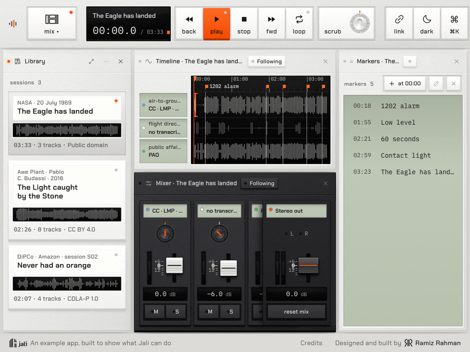
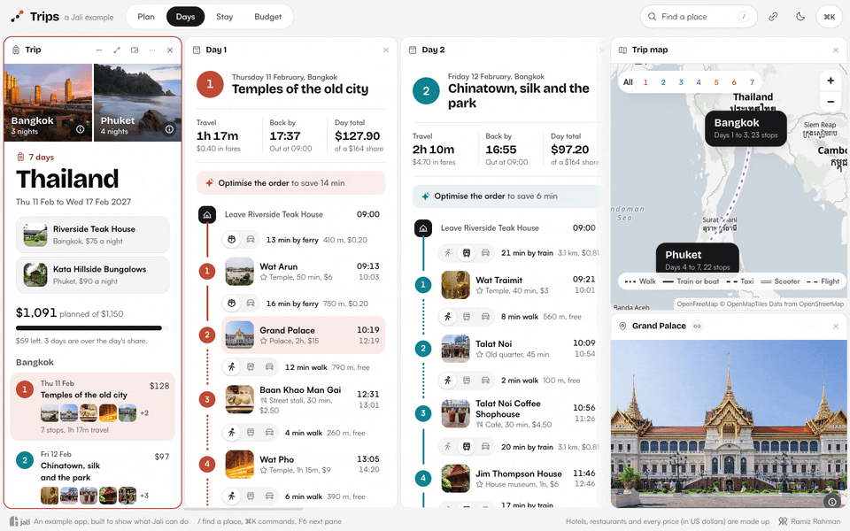
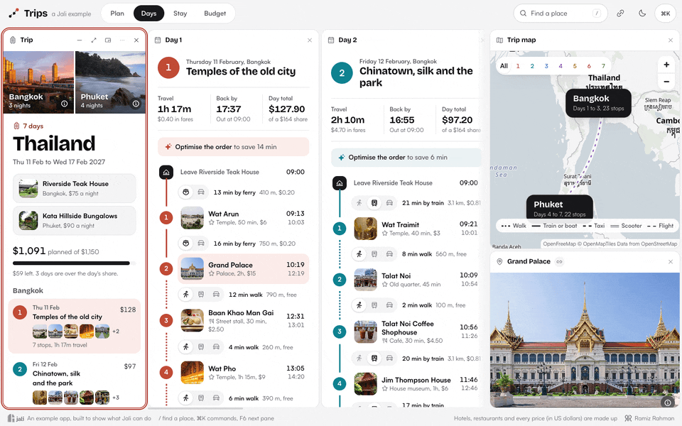
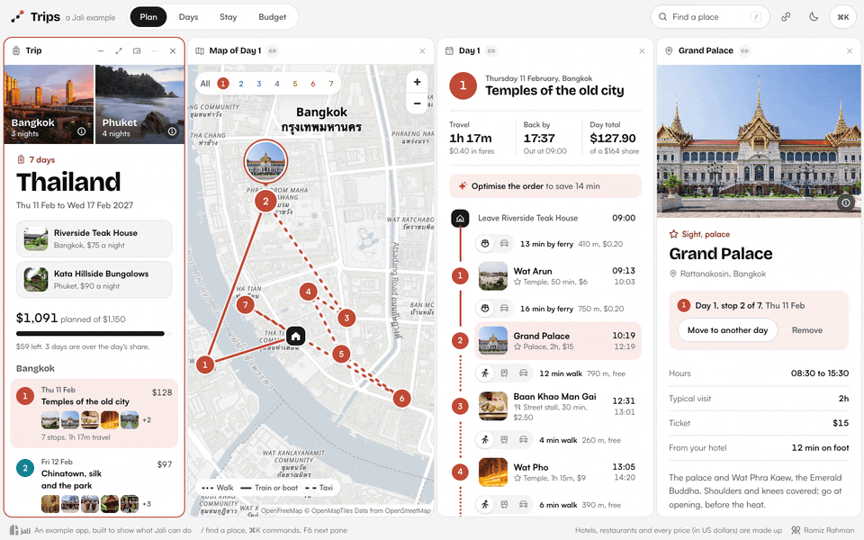

# Auto layout: an adversarial review

Review, 20 Nov 2026. Question: does auto layout (`layout.arrange`, `jali.actions.autoLayout()`, ⌘K "Arrange panes automatically") do what it promises, consistently, on real layouts? Two reviewers looked: Claude read the code, then ran it over every example's presets at five window sizes, in a harness and in the browser. GPT 6.2 Sol (through the Codex CLI, in a read-only sandbox) reviewed the code and wrote its own probes. Claude made the decisions and the changes.

The guide for people using it is [Auto layout](../../apps/docs/src/docs/guides/auto-layout.mdx).

## Verdict

The first version broke its own promises on the layouts it would meet most. It split linked panes, used fewer columns than fit, showed fewer panes than before in one case in eight, flattened rows that scroll sideways, and changed its mind on a second run. It is rewritten. Across the same 85 cases, the new version never shows fewer panes than before, puts 162 linked pairs side by side (the presets had 45 and the first version 53), keeps every row that scrolls, and gives the same layout when run again. The adversarial review then found two ways the rewrite could lose or copy a pane, and five smaller faults. All are fixed, with a test for each.

## How it was tested

A harness built a workspace for every preset of Trips, Markets, Studio and Data Studio (17 presets), at 1920×1080, 1440×900, 1280×800, 1024×768 and 390×844. For each of the 85 cases it ran auto layout twice and measured what showed, what folded, where each linked pair ended up (side by side, stacked, in one tab group, or apart), whether the second run changed anything, and what happened to rows that scroll and to hidden panes. Loan review is a curated page, where auto layout is unavailable.

In the browser, a script recorded the same layouts before and after ⌘K "Arrange panes automatically", frame by frame, into the GIFs below.

| Across 85 cases                        | Before arranging | First version | Now      |
| -------------------------------------- | ---------------- | ------------- | -------- |
| Cases showing fewer panes than before  |                  | 10            | 0        |
| Stable on a second run                 |                  | 68 of 85      | 85 of 85 |
| Linked pairs side by side              | 45               | 53            | 162      |
| Rows that scroll sideways kept         | 5                | 0             | 5        |
| Desktop cases with a pane folded after |                  | 0             | 0        |

## What was wrong, and what it is now

**Linked panes split.** The first version filled a grid down each column, so with two rows a list sat above its detail, not beside it. Trips' Plan at 1440 went from three linked pairs side by side to none. Now panes fill rows across, and a chain of linked panes moves between rows whole, when it fits a row.

**Fewer columns than fit, and fewer panes than before.** It counted columns by comfortable widths, and spread the cells evenly over them. At 1440 Trips' Plan, four panes across, became two by two. At 1024 Studio's Mix went from four panes to one in the browser, Markets' Equities from six to four. Now a row takes every pane that fits at its minimum width, in order, going on past one that doesn't: the fit shares the room out after.

**Rows that scroll sideways flattened.** Trips' week of seven days became a grid of days, and the map and the place went into tabs. Now a row that scrolls is one unit, kept whole, and always gets a place.

**Not stable.** A second run reshuffled 17 of the 85 cases, because tabs re-entered in a different order. Now a tab group's first pane is the one in front, tabs keep their order and stay with the pane whose tabs they are, new nodes are named from the order alone, and the step repeats until it settles. Where it would go round in a cycle (two details of one width taking turns at the last place), it takes the same one every time. A run on an arranged workspace returns the layout unchanged, and the action says `"nothing-to-do"` with no history entry.

**A phone.** On a phone one pane shows at a time, and the first version built a tree for the phone's width, a poor one when the window was wide again. Now the action and the command are unavailable there.

## What GPT 6.2 Sol found, and the decisions

It reviewed the rewrite, since the checkout changed while it ran. Each finding was checked against the code before deciding.

| Finding                                                                                              | Severity | Decision                                                                                                                                                                                                        |
| ---------------------------------------------------------------------------------------------------- | -------- | --------------------------------------------------------------------------------------------------------------------------------------------------------------------------------------------------------------- |
| A pane can be lost when a row that scrolls takes the only place; two strips can lose one             | High     | Fixed. A strip is placed at the end of the last row; a pane always has a pane's cell to be a tab of; and if a pane would be lost or copied, the layout is left as it is.                                        |
| A hidden pane inside a strip is copied                                                               | High     | Fixed: only hidden panes outside a kept strip are placed again. The fit's hide step inside a strip is reported to the fit's owner.                                                                              |
| A row break splits a linked pair                                                                     | Medium   | Fixed: chains move between rows whole, when they fit a row.                                                                                                                                                     |
| A wide pane ends the row early; a tall one vetoes the second row                                     | Medium   | Fixed: a row goes on past a pane that doesn't fit, and the second row checks height pane by pane.                                                                                                               |
| A tab can make its cell too wide, so the fit folds the cell                                          | Medium   | Fixed: a tab goes to the first cell whose row still fits with its width, else the one it widens least.                                                                                                          |
| Repeated runs rename nodes and add history entries; a focused tab changes the order                  | Medium   | Fixed (see "Not stable" above).                                                                                                                                                                                 |
| The pane cap bypasses the fit's priorities, and cap-made tabs stay when the cap rises                | Medium   | Kept, deliberately: auto layout arranges for the room and cap it runs in, and its tabs are tabs like any the person made. The focused pane always shows. Run it again to spread them out. The guide says so.    |
| The agent's automatic arrange ignores the app's policy; auto layout ignores `allow: { move: false }` | Medium   | Fixed: the automatic step asks `allow`, is skipped after a turn that chose the layout (a preset, `setLayout`, its own arrange), and is quiet where unavailable. Auto layout refuses when any pane may not move. |
| The docs describe the first version                                                                  | Low      | Rewritten: the guide, the reference, the presets and agents guides.                                                                                                                                             |
| The action reports success with nothing to arrange (hidden panes); arranging detaches an open peek   | Low      | Fixed: one eligibility check for the action and the command, counting shown panes; the peek keeps its source.                                                                                                   |
| Tucks, folds and fixed sizes are reset; strip children keep theirs; extreme aspect ratios            | Low      | Documented. A tidy-up shows what is open, and a strip is kept as it was arranged.                                                                                                                               |

## What remains

- **The second row is the limit.** In a very tall window, three rows would fit, and auto layout makes two and tabs. That is the documented rule, kept for now: more rows than two make panes too short in most windows.
- **A strip asks for one child.** Beside other panes, a row that scrolls may be left one day wide, where the designed preset gave it two. Auto layout can't know the designer's intent; the preset can be chosen again.
- **The fit's hide step inside a strip** treats the strip as one slot and skips a hidden pane in it. That is the fit's, not auto layout's; reported.

## Tests

`tests/auto-layout.test.ts` holds a test for each behaviour above, each of GPT's cases as a test against the pure function, a property test over 500 random layouts (every pane exactly once, a valid layout, and the same layout when arranged again), and the action's and the agent step's rules. Five of the tests written for Claude's findings fail against the first version; GPT's cases were found on the rewrite, and fail against the version it reviewed.
